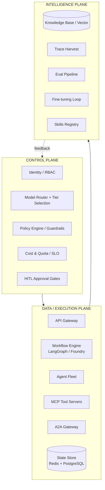
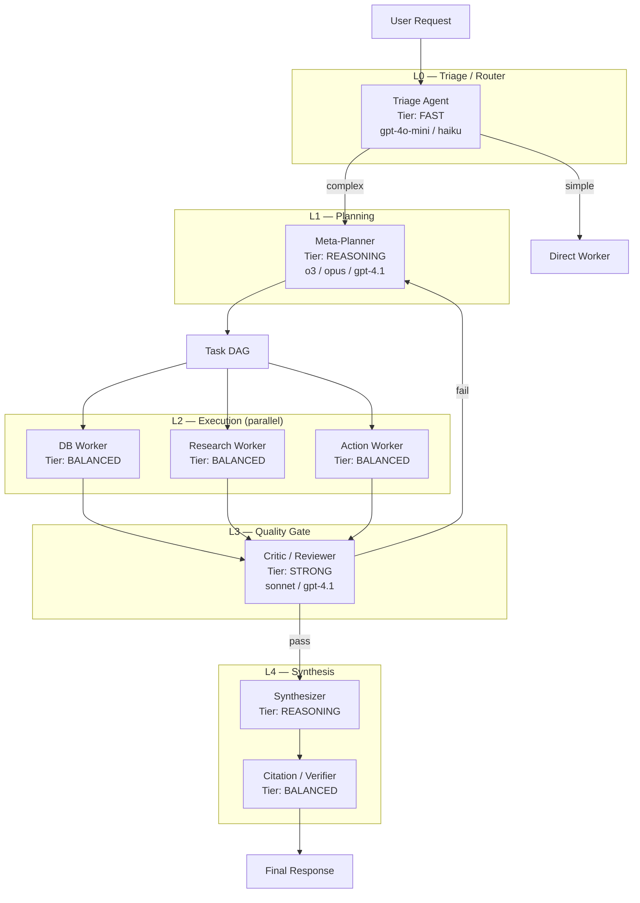
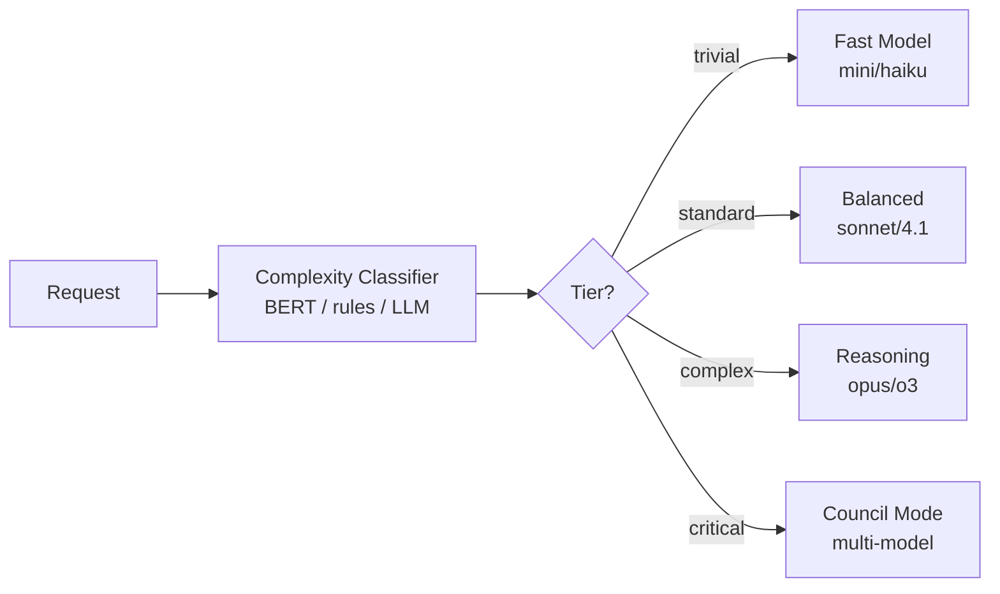
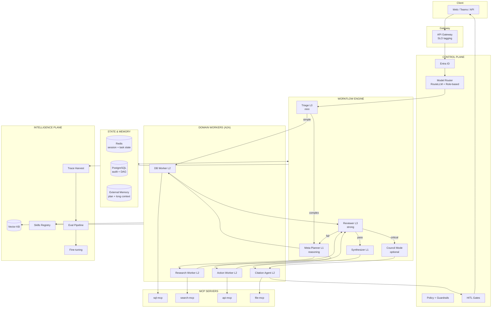

# Multi-Agent Enterprise Architecture v2

> **This document supersedes the v1 design.** The v1 architecture had only Supervisor + Workers — it lacked model tiering, context engineering, a review/synthesis loop, and a control plane. v2 is based on production patterns from Anthropic Research, LangGraph, RouteLLM, llm-council (Karpathy), Microsoft Agent Framework, and Google ADK.

---

## 1. Problems with the v1 Design

| Gap | Consequence |
|-----|-------------|
| Every agent shared one model | High cost, high latency, or low quality |
| No separation of Planner / Worker / Reviewer / Synthesizer roles | Agents took on too much work; hallucinations increased |
| No Model Router | No cost/quality tradeoff optimization |
| No Context Engineering | Context window blowup after 10–20 steps |
| No Control Plane | No audit, policy, or quota enforcement |
| Workers = simple agents | No adversarial review for important tasks |
| No Intelligence Plane | No feedback loop → no fine-tuning |

---

## 2. Three Planes — Enterprise Foundation

References: [Mercor Three Planes](https://www.mercor.com/blog/the-three-planes-of-enterprise-agent-systems/), [System of Intelligence Pattern](https://theagentichive.com/the-system-of-intelligence-pattern-architecting-enterprise-ai-that-respects-systems-of-record-037430da3b34)



### Control Plane — "What is allowed?"
- **Identity**: Entra ID, user context delegation
- **Model Router**: Select model tier by task complexity, SLO, and cost budget
- **Policy Engine**: RBAC, data sensitivity, egress rules
- **HITL Gates**: Write DB, send email, financial actions
- **Quota**: Token budget per user/team/request

### Data/Execution Plane — "Execute the work"
- Workflow engine (stateful, durable, checkpointing)
- Agent fleet with A2A
- MCP tool servers
- Shared state (do not dump full history into every agent)

### Intelligence Plane — "Learn and improve"
- Knowledge base (RAG)
- Trace → eval dataset → fine-tune
- Skills registry (domain knowledge)
- Regression detection

---

## 3. Agent Role Taxonomy — NOT "more agents = more copies of the same model"

**Principle:** Each **role** has its own **model tier**, **context budget**, and **tools**.



### Role × model tier table

| Role | Purpose | Model Tier | Example Models | Context Budget | When to use |
|------|---------|------------|----------------|----------------|-------------|
| **Triage** | Classify intent, route | **FAST** (L0) | gpt-4o-mini, haiku | 8K | Every request |
| **Meta-Planner** | Decompose task → DAG | **REASONING** (L1) | o3, claude-opus, gpt-4.1 | 32K + external memory | Complex, multi-step tasks |
| **Domain Worker** | Execute one sub-task | **BALANCED** (L2) | gpt-4.1, sonnet | 16K isolated | Query DB, search, API call |
| **Micro-Worker** | Format, classify, extract | **FAST** (L0) | mini, haiku | 4K | Simple sub-tasks |
| **Critic/Reviewer** | Review output, catch errors | **STRONG** (L3) | sonnet, gpt-4.1 | 16K | Before returning to user; sensitive tasks |
| **Synthesizer** | Combine multi-agent results | **REASONING** (L1) | opus, gpt-4.1 | 32K | After parallel workers |
| **Citation Agent** | Verify sources, add citations | **BALANCED** (L2) | sonnet | 64K (docs) | Research, legal |
| **Chairman** | Council synthesis | **REASONING** (L1) | opus, gemini-pro | 64K | High-stakes decisions |

### Model assignment rules

```
1. Triage ALWAYS uses the cheapest model — classify + route only
2. Planner uses the strongest model — DAG decisions affect the entire flow
3. Workers use balanced models — 80% of workload, cost-sensitive
4. Reviewer MUST NOT use a weak model — this is the safety net
5. Synthesizer uses a strong model — this is the final output the user sees
6. Per-step routing (CASTER pattern): before EACH agent node, the router decides the tier
```

---

## 4. Model Router — Dynamic Tiering

References: [RouteLLM](https://github.com/lm-sys/RouteLLM), [CASTER paper](https://arxiv.org/pdf/2601.19793v1), [Zylos Model Routing](https://zylos.ai/research/2026-03-02-ai-agent-model-routing/)



### Three routing mechanisms (combined)

| Mechanism | Description | When to use |
|-----------|-------------|-------------|
| **Role-based** | Fixed model per agent role | Default, predictable |
| **Query-based** | RouteLLM classifier per request | Cost optimization |
| **Step-based** | Router before each graph node (CASTER) | LangGraph workflows |

### Cost tiers (Azure OpenAI example)

| Tier | Model | Cost relative | Latency | Use |
|------|-------|---------------|---------|-----|
| T0 | gpt-4o-mini | 1× | ~1s | Triage, classify, format |
| T1 | gpt-4.1 | 5× | ~3s | Workers, review |
| T2 | o3 / claude-opus | 15× | ~10s | Planning, synthesis |
| T3 | Council (3+ models) | 30×+ | ~20s | Legal decisions, financial |

### SLO-based routing

```yaml
# Each request has an SLO tier from the API edge
slo_tiers:
  standard:    # 95% requests
    max_model: T1
    max_latency_ms: 10000
    council_enabled: false
  premium:     # Enterprise customers
    max_model: T2
    max_latency_ms: 30000
    council_enabled: false
  critical:    # Legal, financial
    max_model: T3
    council_enabled: true
    reviewer_required: true
```

---

## 5. Context Engineering — Managing the Context Window

References: [LangChain Context Engineering](https://www.langchain.com/blog/context-engineering-for-agents), [Anthropic Multi-Agent Research](https://www.anthropic.com/engineering/multi-agent-research-system), [LangGraph Supervisor](https://callsphere.ai/blog/langgraph-supervisor-multi-agent-orchestration-2026.md)

### 5.1 Core principles

> **"More agents = more separate context windows"** — Anthropic

| Pattern | Description | Ref |
|---------|-------------|-----|
| **Context Isolation** | Each subagent has its own context window; no cross-talk | Anthropic Research |
| **Shared State Schema** | Agents write results to state keys; do not dump full conversation | LangGraph |
| **last_message mode** | Supervisor receives only the last message from the worker | LangGraph Supervisor |
| **Summarization Middleware** | Summarize old history before calling the model | LangGraph pre_model_hook |
| **External Memory** | Plan + findings persist when > 200K tokens | Anthropic Research |
| **Scratchpad** | Thread-scoped state for intermediate results | LangGraph checkpointing |

### 5.2 State Schema (shared, typed)

```python
class AgentState(TypedDict):
  # Metadata
  session_id: str
  user_id: str
  trace_id: str

  # Planning (Meta-Planner writes, all read)
  plan: str                    # Master plan (persisted to external memory)
  task_dag: list[TaskNode]     # DAG of sub-tasks

  # Results (Workers write, Synthesizer reads)
  db_results: dict | None      # Condensed DB findings
  research_results: dict | None
  action_results: dict | None

  # Quality (Reviewer writes)
  review_status: Literal["pending", "pass", "fail", "revise"]
  review_notes: str | None

  # Messages (ONLY for current agent's turn)
  messages: Annotated[list, add_messages]  # LangGraph reducer

  # Token tracking
  token_budget_remaining: int
```

**Important:** Workers write `db_results` (condensed); they do NOT dump the entire SQL conversation into `messages`.

### 5.3 Token Budget per Role

| Role | Max Input | Max Output | Overflow Strategy |
|------|-----------|------------|-------------------|
| Triage | 4K | 500 | Truncate history |
| Planner | 32K | 4K | External memory |
| Worker | 16K | 2K | Summarize tool results |
| Reviewer | 16K | 2K | Only review target + criteria |
| Synthesizer | 32K | 8K | Summarize worker outputs first |
| Citation | 64K | 4K | Chunk documents |

### 5.4 Context flow in multi-agent

```
User: "Find contract ABC, analyze payment terms, send report"

[Planner — 32K context]
  Input: user message + skills metadata
  Output: task_dag = [task1: db_query, task2: legal_analysis, task3: report]
  Writes: state.plan, state.task_dag

[DB Worker — 16K ISOLATED context]
  Input: "Query contracts WHERE client LIKE '%ABC%'"  (sub-task only)
  Tools: sql-mcp
  Output: state.db_results = {contracts: [...], sql: "..."}
  Does NOT see: research task, user full history

[Research Worker — 16K ISOLATED context]
  Input: "Analyze payment terms for contract ABC Corp"
  Tools: search-mcp
  Output: state.research_results = {findings: "...", sources: [...]}

[Reviewer — 16K context]
  Input: state.db_results + state.research_results + review criteria
  Output: state.review_status = "pass"

[Synthesizer — 32K context]
  Input: state.db_results + state.research_results (condensed)
  Output: final draft

[Citation Agent — 64K context]
  Input: draft + source documents
  Output: final response with citations
```

### 5.5 Anti-patterns (avoid)

| ❌ Avoid | ✅ Use instead |
|----------|----------------|
| `output_mode="full_history"` in prod | `last_message` + log full to LangSmith |
| Pass full conversation to every worker | Pass only sub-task description |
| No token budget | Per-role budget + summarization |
| Single 128K context for everything | Isolated contexts per subagent |
| Store tool raw output in messages | Condense → write to state key |

---

## 6. Execution Topologies — 4 modes

Not every request runs the full pipeline. **Triage decides the topology.**

### Mode 1: Direct (60% requests)
```
Triage → Worker → Response
```
- Simple query: "How many active contracts are there?"
- 1 agent, 1 tool call, FAST model

### Mode 2: Planned (30% requests)
```
Triage → Planner → Worker(s) → Synthesizer → Response
```
- Multi-step: "Find contract ABC and summarize it"
- Planner creates DAG, workers run in parallel, synthesizer combines results

### Mode 3: Reviewed (8% requests)
```
Triage → Planner → Workers → Reviewer → [retry?] → Synthesizer → Response
```
- Sensitive: financial data, legal analysis
- Reviewer catches errors before returning to the user

### Mode 4: Council (2% requests — high-stakes)
```
Triage → Planner → Workers → Council(Propose → Peer Review → Chairman) → Response
```
Reference: [llm-council (Karpathy)](https://github.com/karpathy/llm-council)
- Legal decisions, contract review, compliance
- 3 stages: independent responses → anonymous peer review → chairman synthesis

---

## 7. Topology Patterns — Choose the right pattern

| Pattern | Agents | When to use | Cost | Ref |
|---------|--------|-------------|------|-----|
| **Supervisor** | 1 + N workers | 90% use cases | Medium | LangGraph |
| **Hierarchical** | Supervisor of supervisors | >8 specialists | High | LangGraph |
| **Council** | N + chairman | High-stakes decisions | Very High | llm-council |
| **Pipeline** | A → B → C | Deterministic ETL | Low | Google ADK Sequential |
| **Handoff** | Triage → specialist owns | Customer support | Low | OpenAI Agents SDK |
| **Agents-as-Tools** | Manager calls workers | Manager synthesizes | Medium | OpenAI Agents SDK |

**Recommended approach:**
- Default: **Supervisor** (Mode 1–3)
- Legal/contract: **Council** (Mode 4)
- ETL/reporting: **Pipeline**
- Max hierarchy depth: **2 levels** (LangGraph recommendation)

---

## 8. Full Architecture Diagram



---

## 9. Agent Fleet Definition

### 9.1 Control Agents (no tools, reasoning only)

| Agent | Model | Tools | A2A |
|-------|-------|-------|-----|
| Triage | T0 (mini) | None | Routes to workers |
| Meta-Planner | T2 (reasoning) | `create_task_dag`, `read_memory` | Spawns workers |
| Reviewer | T1 (strong) | None | Reads worker outputs |
| Synthesizer | T2 (reasoning) | None | Reads state |
| Chairman | T2 (reasoning) | None | Council mode only |

### 9.2 Domain Workers (with MCP tools)

| Agent | Model | MCP Tools | A2A Endpoint |
|-------|-------|-----------|--------------|
| DB Worker | T1 | sql-mcp | `/agents/db-worker/a2a` |
| Research Worker | T1 | search-mcp, web-search | `/agents/research-worker/a2a` |
| Action Worker | T1 | api-mcp | `/agents/action-worker/a2a` |
| Citation Agent | T1 | file-mcp, search-mcp | `/agents/citation-agent/a2a` |
| Code Worker | T1 | code-interpreter, file-mcp | `/agents/code-worker/a2a` |

### 9.3 Each agent = 1 model + 1 context budget + 1 toolset + 1 A2A endpoint

```yaml
# agents/db-worker/agent.yaml
name: db-worker
role: domain_worker
model:
  tier: T1
  deployment: gpt-4.1
  fallback: gpt-4o-mini  # if T1 unavailable
context:
  max_input_tokens: 16384
  max_output_tokens: 2048
  isolation: true          # fresh context per sub-task
  overflow: summarize_tool_results
tools:
  - type: mcp
    server: sql-mcp
    permissions: [read]
skills:
  - database-query
a2a:
  endpoint: /agents/db-worker/a2a
  skills:
    - id: query-database
      description: Execute read-only SQL queries on behalf of user
security:
  rbac: db-reader
  hitl_required: false
  audit: all_queries
```

---

## 10. Security (supplement)

| Layer | Control |
|-------|---------|
| Control Plane | Entra ID, SLO tiers, model allowlist per data sensitivity |
| Agent | Managed Identity, 1 role = 1 model = 1 toolset |
| MCP | Tool-level permissions, input validation, row limits |
| A2A | mTLS, agent card verification, scoped delegation |
| Context | PII redaction before cross-agent transfer |
| Council | Anonymized peer review (prevent model favoritism) |

---

## 11. Observability (supplement)

Each trace must capture:

```json
{
  "trace_id": "...",
  "topology_mode": "planned",
  "agents_invoked": [
    {"name": "triage", "model": "gpt-4o-mini", "tokens": 450, "latency_ms": 800},
    {"name": "planner", "model": "gpt-4.1", "tokens": 3200, "latency_ms": 4500},
    {"name": "db-worker", "model": "gpt-4.1", "tokens": 1800, "latency_ms": 3200}
  ],
  "model_routing_decisions": [
    {"step": "triage", "tier": "T0", "reason": "role_based"},
    {"step": "planner", "tier": "T2", "reason": "complexity_score=0.85"}
  ],
  "context_budget_usage": {
    "planner": {"used": 12000, "budget": 32000},
    "db-worker": {"used": 4500, "budget": 16384}
  },
  "review_status": "pass",
  "total_cost_usd": 0.045,
  "total_latency_ms": 12500
}
```

---

## 12. ADRs (updated)

### ADR-005: Model Tiering per Role
**Decision:** Each agent role has a fixed model tier + dynamic routing per step.
**Rationale:** 80% cost savings on triage/routing; quality where it matters.

### ADR-006: Context Isolation
**Decision:** Subagents receive isolated context and write results to a shared state schema.
**Rationale:** Anthropic Research proved 90% improvement; prevents context blowup.

### ADR-007: Reviewer Gate
**Decision:** Sensitive tasks (legal, financial) must pass through Reviewer before output.
**Rationale:** LLM Council pattern — adversarial review catches hallucinations.

### ADR-008: Council Mode for Critical
**Decision:** SLO tier "critical" activates Council mode (3-stage deliberation).
**Rationale:** Karpathy llm-council — multi-model consensus for high-stakes.

### ADR-009: Framework Selection
**Decision:** LangGraph (orchestration) + Foundry (hosting) + MCP (tools) + A2A (inter-agent).
**Rationale:** LangGraph = best state management; Foundry = enterprise deploy; MCP/A2A = open standards.

---

## 13. Data Layer — PostgreSQL (local-first)

> Details: [09-INFRASTRUCTURE.md](09-INFRASTRUCTURE.md) | Source: [langgraph-checkpoint-postgres](https://github.com/langchain-ai/langgraph/tree/main/libs/checkpoint-postgres)

### Principles

- **PostgreSQL from day one** — local via Docker, cloud later (Azure PostgreSQL Flexible)
- **No SQLite** — local dev uses PostgresSaver like production
- **2 schemas** in one local instance; can split servers in the cloud

| Schema | Tables | Access |
|--------|--------|--------|
| `app` | clients, contracts, documents | DB Worker via sql-mcp (`agent_reader`, SELECT only) |
| `platform` | sessions, task_dag, audit_log, checkpoints | Workflow engine, Gateway |

### Local → Cloud (zero code change)

```
Local:  DATABASE_URL=postgresql://...@localhost:5432/multiagent
Cloud:  DATABASE_URL=postgresql://...@server.postgres.database.azure.com/multiagent?sslmode=require
```

Change only the connection string in `.env` / Key Vault.

---

## 14. Related Documentation

| Doc | Content |
|-----|---------|
| [Infrastructure](09-INFRASTRUCTURE.md) | PostgreSQL local, Docker, cloud migration |
| [GitHub Reference Map](10-GITHUB-ARCHITECTURE-MAP.md) | 25+ repos mapped to architecture decisions |
| [Model Tiering](06-MODEL-TIERING.md) | Router, cost, SLO |
| [Context Engineering](07-CONTEXT-ENGINEERING.md) | Token budget, state schema, memory |
| [Reference Repos](08-REFERENCE-REPOS.md) | Framework survey |
| [A2A & MCP Guide](04-A2A-MCP-GUIDE.md) | Protocol implementation |
| [Skills System](05-SKILLS-SYSTEM.md) | Domain knowledge modules |
