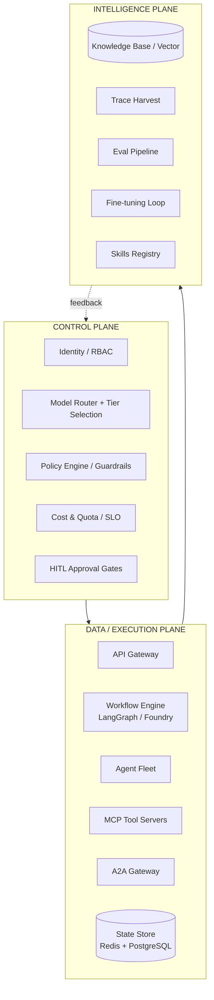
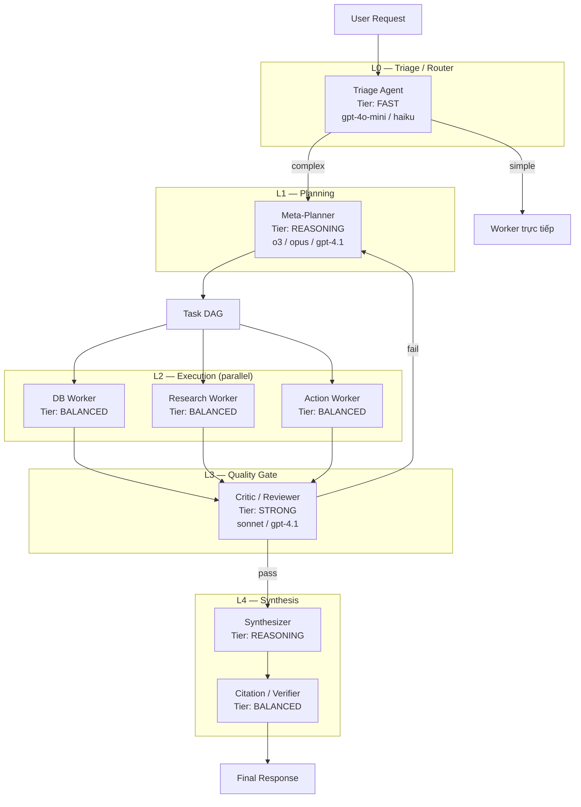
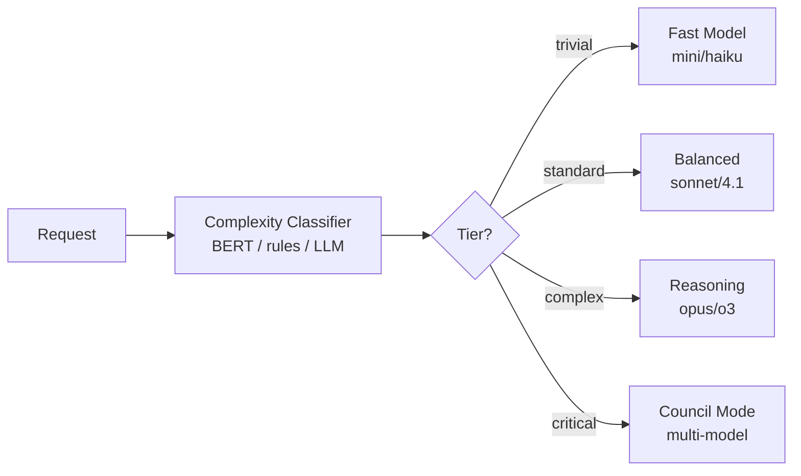
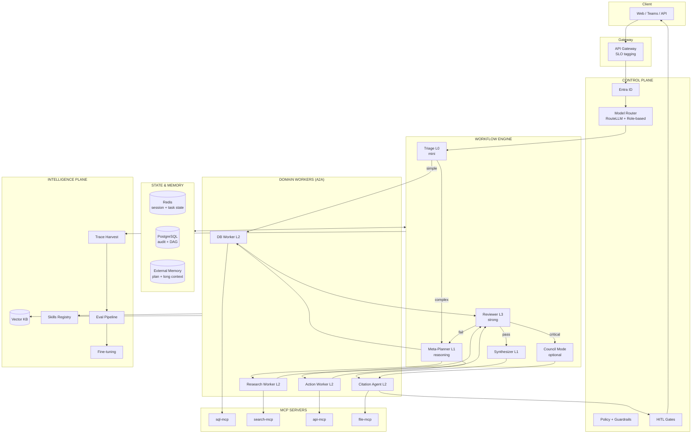

> **English guides:** [README](../README.md) · [Local setup](12-LOCAL-SETUP.md) · [Docs index](README.md)  
> This document may still contain Vietnamese in places; prefer the English guides above for running the project.

# Kiến trúc Multi-Agent Enterprise v2

> **Tài liệu này thay thế thiết kế v1.** Kiến trúc v1 chỉ có Supervisor + Workers — thiếu phân cấp model, context engineering, review/synthesis loop, và control plane. v2 dựa trên các pattern production từ Anthropic Research, LangGraph, RouteLLM, llm-council (Karpathy), Microsoft Agent Framework, Google ADK.

---

## 1. Vấn đề của thiết kế v1

| Thiếu sót | Hậu quả |
|-----------|----------|
| Mọi agent dùng chung 1 model | Chi phí cao, latency cao, hoặc chất lượng thấp |
| Không phân vai Planner / Worker / Reviewer / Synthesizer | Agent "ôm" quá nhiều việc, hallucination tăng |
| Không có Model Router | Không tối ưu cost/quality tradeoff |
| Không có Context Engineering | Context window blowup sau 10–20 bước |
| Không có Control Plane | Không audit, không policy, không quota |
| Workers = Agents đơn giản | Thiếu adversarial review cho task quan trọng |
| Không có Intelligence Plane | Không có feedback loop → fine-tune |

---

## 2. Ba Plane — Nền tảng Enterprise

Tham chiếu: [Mercor Three Planes](https://www.mercor.com/blog/the-three-planes-of-enterprise-agent-systems/), [System of Intelligence Pattern](https://theagentichive.com/the-system-of-intelligence-pattern-architecting-enterprise-ai-that-respects-systems-of-record-037430da3b34)



### Control Plane — "Được phép làm gì?"
- **Identity**: Entra ID, user context delegation
- **Model Router**: Chọn model tier theo task complexity, SLO, cost budget
- **Policy Engine**: RBAC, data sensitivity, egress rules
- **HITL Gates**: Write DB, send email, financial actions
- **Quota**: Token budget per user/team/request

### Data/Execution Plane — "Thực thi công việc"
- Workflow engine (stateful, durable, checkpointing)
- Agent fleet với A2A
- MCP tool servers
- Shared state (không dump full history vào mọi agent)

### Intelligence Plane — "Học và cải thiện"
- Knowledge base (RAG)
- Trace → eval dataset → fine-tune
- Skills registry (domain knowledge)
- Regression detection

---

## 3. Agent Role Taxonomy — KHÔNG phải "nhiều agent = nhiều copy cùng model"

**Nguyên tắc:** Mỗi **vai trò** (role) có **model tier riêng**, **context budget riêng**, **tools riêng**.



### Bảng vai trò × model tier

| Role | Vai trò | Model Tier | Ví dụ Model | Context Budget | Khi nào dùng |
|------|---------|------------|-------------|----------------|--------------|
| **Triage** | Phân loại intent, route | **FAST** (L0) | gpt-4o-mini, haiku | 8K | Mọi request |
| **Meta-Planner** | Phân rã task → DAG | **REASONING** (L1) | o3, claude-opus, gpt-4.1 | 32K + external memory | Task phức tạp, multi-step |
| **Domain Worker** | Thực thi 1 sub-task | **BALANCED** (L2) | gpt-4.1, sonnet | 16K isolated | Query DB, search, API call |
| **Micro-Worker** | Format, classify, extract | **FAST** (L0) | mini, haiku | 4K | Sub-task đơn giản |
| **Critic/Reviewer** | Review output, catch errors | **STRONG** (L3) | sonnet, gpt-4.1 | 16K | Trước khi trả user, task nhạy cảm |
| **Synthesizer** | Tổng hợp multi-agent results | **REASONING** (L1) | opus, gpt-4.1 | 32K | Sau parallel workers |
| **Citation Agent** | Verify sources, add citations | **BALANCED** (L2) | sonnet | 64K (docs) | Research, legal |
| **Chairman** | Council synthesis | **REASONING** (L1) | opus, gemini-pro | 64K | High-stakes decisions |

### Quy tắc gán model

```
1. Triage LUÔN dùng model rẻ nhất — chỉ classify + route
2. Planner dùng model mạnh nhất — quyết định DAG ảnh hưởng toàn flow
3. Workers dùng model cân bằng — 80% workload, cost-sensitive
4. Reviewer KHÔNG dùng model yếu — đây là safety net
5. Synthesizer dùng model mạnh — output cuối cùng user thấy
6. Per-step routing (CASTER pattern): trước MỖI agent node, router quyết định tier
```

---

## 4. Model Router — Phân cấp động

Tham chiếu: [RouteLLM](https://github.com/lm-sys/RouteLLM), [CASTER paper](https://arxiv.org/pdf/2601.19793v1), [Zylos Model Routing](https://zylos.ai/research/2026-03-02-ai-agent-model-routing/)



### 3 cơ chế routing (kết hợp)

| Cơ chế | Mô tả | Khi nào |
|--------|--------|---------|
| **Role-based** | Model cố định theo agent role | Default, predictable |
| **Query-based** | RouteLLM classifier per request | Cost optimization |
| **Step-based** | Router trước mỗi graph node (CASTER) | LangGraph workflows |

### Cost tiers (ví dụ Azure OpenAI)

| Tier | Model | Cost relative | Latency | Use |
|------|-------|---------------|---------|-----|
| T0 | gpt-4o-mini | 1× | ~1s | Triage, classify, format |
| T1 | gpt-4.1 | 5× | ~3s | Workers, review |
| T2 | o3 / claude-opus | 15× | ~10s | Planning, synthesis |
| T3 | Council (3+ models) | 30×+ | ~20s | Legal decisions, financial |

### SLO-based routing

```yaml
# Mỗi request có SLO tier từ API edge
slo_tiers:
  standard:    # 95% requests
    max_model: T1
    max_latency_ms: 10000
    council_enabled: false
  premium:     # Enterprise customers
    max_model: T2
    max_latency_ms: 30000
    council_enabled: false
  critical:    # Legal, financial
    max_model: T3
    council_enabled: true
    reviewer_required: true
```

---

## 5. Context Engineering — Quản lý Context Window

Tham chiếu: [LangChain Context Engineering](https://www.langchain.com/blog/context-engineering-for-agents), [Anthropic Multi-Agent Research](https://www.anthropic.com/engineering/multi-agent-research-system), [LangGraph Supervisor](https://callsphere.ai/blog/langgraph-supervisor-multi-agent-orchestration-2026.md)

### 5.1 Nguyên tắc cốt lõi

> **"Nhiều agent = nhiều context window riêng biệt"** — Anthropic

| Pattern | Mô tả | Ref |
|---------|--------|-----|
| **Context Isolation** | Mỗi subagent có context window riêng, không thấy cross-talk | Anthropic Research |
| **Shared State Schema** | Agents ghi kết quả vào state keys, không dump full conversation | LangGraph |
| **last_message mode** | Supervisor chỉ nhận message cuối từ worker | LangGraph Supervisor |
| **Summarization Middleware** | Tóm tắt history cũ trước khi gọi model | LangGraph pre_model_hook |
| **External Memory** | Plan + findings persist khi > 200K tokens | Anthropic Research |
| **Scratchpad** | Thread-scoped state cho intermediate results | LangGraph checkpointing |

### 5.2 State Schema (shared, typed)

```python
class AgentState(TypedDict):
  # Metadata
  session_id: str
  user_id: str
  trace_id: str

  # Planning (Meta-Planner writes, all read)
  plan: str                    # Master plan (persisted to external memory)
  task_dag: list[TaskNode]     # DAG of sub-tasks

  # Results (Workers write, Synthesizer reads)
  db_results: dict | None      # Condensed DB findings
  research_results: dict | None
  action_results: dict | None

  # Quality (Reviewer writes)
  review_status: Literal["pending", "pass", "fail", "revise"]
  review_notes: str | None

  # Messages (ONLY for current agent's turn)
  messages: Annotated[list, add_messages]  # LangGraph reducer

  # Token tracking
  token_budget_remaining: int
```

**Quan trọng:** Workers ghi `db_results` (condensed), KHÔNG dump toàn bộ SQL conversation vào `messages`.

### 5.3 Token Budget per Role

| Role | Max Input | Max Output | Overflow Strategy |
|------|-----------|------------|-------------------|
| Triage | 4K | 500 | Truncate history |
| Planner | 32K | 4K | External memory |
| Worker | 16K | 2K | Summarize tool results |
| Reviewer | 16K | 2K | Only review target + criteria |
| Synthesizer | 32K | 8K | Summarize worker outputs first |
| Citation | 64K | 4K | Chunk documents |

### 5.4 Context flow trong multi-agent

```
User: "Tìm hợp đồng ABC, phân tích điều khoản thanh toán, gửi báo cáo"

[Planner — 32K context]
  Input: user message + skills metadata
  Output: task_dag = [task1: db_query, task2: legal_analysis, task3: report]
  Writes: state.plan, state.task_dag

[DB Worker — 16K ISOLATED context]
  Input: "Query contracts WHERE client LIKE '%ABC%'"  (chỉ sub-task)
  Tools: sql-mcp
  Output: state.db_results = {contracts: [...], sql: "..."}
  KHÔNG thấy: research task, user full history

[Research Worker — 16K ISOLATED context]
  Input: "Analyze payment terms for contract ABC Corp"
  Tools: search-mcp
  Output: state.research_results = {findings: "...", sources: [...]}

[Reviewer — 16K context]
  Input: state.db_results + state.research_results + review criteria
  Output: state.review_status = "pass"

[Synthesizer — 32K context]
  Input: state.db_results + state.research_results (condensed)
  Output: final draft

[Citation Agent — 64K context]
  Input: draft + source documents
  Output: final response with citations
```

### 5.5 Anti-patterns (tránh)

| ❌ Tránh | ✅ Thay bằng |
|----------|-------------|
| `output_mode="full_history"` in prod | `last_message` + log full to LangSmith |
| Pass full conversation to every worker | Pass only sub-task description |
| No token budget | Per-role budget + summarization |
| Single 128K context for everything | Isolated contexts per subagent |
| Store tool raw output in messages | Condense → write to state key |

---

## 6. Execution Topologies — 4 modes

Không phải mọi request đều chạy full pipeline. **Triage quyết định topology.**

### Mode 1: Direct (60% requests)
```
Triage → Worker → Response
```
- Simple query: "Có bao nhiêu hợp đồng active?"
- 1 agent, 1 tool call, FAST model

### Mode 2: Planned (30% requests)
```
Triage → Planner → Worker(s) → Synthesizer → Response
```
- Multi-step: "Tìm hợp đồng ABC và tóm tắt"
- Planner tạo DAG, workers parallel, synthesizer combine

### Mode 3: Reviewed (8% requests)
```
Triage → Planner → Workers → Reviewer → [retry?] → Synthesizer → Response
```
- Sensitive: financial data, legal analysis
- Reviewer catch errors trước khi trả user

### Mode 4: Council (2% requests — high-stakes)
```
Triage → Planner → Workers → Council(Propose → Peer Review → Chairman) → Response
```
Tham chiếu: [llm-council (Karpathy)](https://github.com/karpathy/llm-council)
- Legal decisions, contract review, compliance
- 3 stages: independent responses → anonymous peer review → chairman synthesis

---

## 7. Topology Patterns — Chọn đúng pattern

| Pattern | Agents | Khi nào | Cost | Ref |
|---------|--------|---------|------|-----|
| **Supervisor** | 1 + N workers | 90% use cases | Medium | LangGraph |
| **Hierarchical** | Supervisor of supervisors | >8 specialists | High | LangGraph |
| **Council** | N + chairman | High-stakes decisions | Very High | llm-council |
| **Pipeline** | A → B → C | Deterministic ETL | Low | Google ADK Sequential |
| **Handoff** | Triage → specialist owns | Customer support | Low | OpenAI Agents SDK |
| **Agents-as-Tools** | Manager calls workers | Manager synthesizes | Medium | OpenAI Agents SDK |

**Recommended approach:**
- Default: **Supervisor** (Mode 1–3)
- Legal/contract: **Council** (Mode 4)
- ETL/reporting: **Pipeline**
- Max hierarchy depth: **2 levels** (LangGraph recommendation)

---

## 8. Full Architecture Diagram



---

## 9. Agent Fleet Definition

### 9.1 Control Agents (không có tools, chỉ reasoning)

| Agent | Model | Tools | A2A |
|-------|-------|-------|-----|
| Triage | T0 (mini) | None | Routes to workers |
| Meta-Planner | T2 (reasoning) | `create_task_dag`, `read_memory` | Spawns workers |
| Reviewer | T1 (strong) | None | Reads worker outputs |
| Synthesizer | T2 (reasoning) | None | Reads state |
| Chairman | T2 (reasoning) | None | Council mode only |

### 9.2 Domain Workers (có MCP tools)

| Agent | Model | MCP Tools | A2A Endpoint |
|-------|-------|-----------|--------------|
| DB Worker | T1 | sql-mcp | `/agents/db-worker/a2a` |
| Research Worker | T1 | search-mcp, web-search | `/agents/research-worker/a2a` |
| Action Worker | T1 | api-mcp | `/agents/action-worker/a2a` |
| Citation Agent | T1 | file-mcp, search-mcp | `/agents/citation-agent/a2a` |
| Code Worker | T1 | code-interpreter, file-mcp | `/agents/code-worker/a2a` |

### 9.3 Mỗi agent = 1 model + 1 context budget + 1 toolset + 1 A2A endpoint

```yaml
# agents/db-worker/agent.yaml
name: db-worker
role: domain_worker
model:
  tier: T1
  deployment: gpt-4.1
  fallback: gpt-4o-mini  # if T1 unavailable
context:
  max_input_tokens: 16384
  max_output_tokens: 2048
  isolation: true          # fresh context per sub-task
  overflow: summarize_tool_results
tools:
  - type: mcp
    server: sql-mcp
    permissions: [read]
skills:
  - database-query
a2a:
  endpoint: /agents/db-worker/a2a
  skills:
    - id: query-database
      description: Execute read-only SQL queries on behalf of user
security:
  rbac: db-reader
  hitl_required: false
  audit: all_queries
```

---

## 10. Security (bổ sung)

| Layer | Control |
|-------|---------|
| Control Plane | Entra ID, SLO tiers, model allowlist per data sensitivity |
| Agent | Managed Identity, 1 role = 1 model = 1 toolset |
| MCP | Tool-level permissions, input validation, row limits |
| A2A | mTLS, agent card verification, scoped delegation |
| Context | PII redaction before cross-agent transfer |
| Council | Anonymized peer review (prevent model favoritism) |

---

## 11. Observability (bổ sung)

Mỗi trace phải capture:

```json
{
  "trace_id": "...",
  "topology_mode": "planned",
  "agents_invoked": [
    {"name": "triage", "model": "gpt-4o-mini", "tokens": 450, "latency_ms": 800},
    {"name": "planner", "model": "gpt-4.1", "tokens": 3200, "latency_ms": 4500},
    {"name": "db-worker", "model": "gpt-4.1", "tokens": 1800, "latency_ms": 3200}
  ],
  "model_routing_decisions": [
    {"step": "triage", "tier": "T0", "reason": "role_based"},
    {"step": "planner", "tier": "T2", "reason": "complexity_score=0.85"}
  ],
  "context_budget_usage": {
    "planner": {"used": 12000, "budget": 32000},
    "db-worker": {"used": 4500, "budget": 16384}
  },
  "review_status": "pass",
  "total_cost_usd": 0.045,
  "total_latency_ms": 12500
}
```

---

## 12. ADRs (cập nhật)

### ADR-005: Model Tiering per Role
**Quyết định:** Mỗi agent role có model tier cố định + dynamic routing per step.
**Lý do:** 80% cost savings on triage/routing; quality where it matters.

### ADR-006: Context Isolation
**Quyết định:** Subagents nhận isolated context, ghi kết quả vào shared state schema.
**Lý do:** Anthropic Research proved 90% improvement; prevents context blowup.

### ADR-007: Reviewer Gate
**Quyết định:** Task nhạy cảm (legal, financial) bắt buộc qua Reviewer trước output.
**Lý do:** LLM Council pattern — adversarial review catches hallucinations.

### ADR-008: Council Mode for Critical
**Quyết định:** SLO tier "critical" kích hoạt Council mode (3-stage deliberation).
**Lý do:** Karpathy llm-council — multi-model consensus for high-stakes.

### ADR-009: Framework Selection
**Quyết định:** LangGraph (orchestration) + Foundry (hosting) + MCP (tools) + A2A (inter-agent).
**Lý do:** LangGraph = best state management; Foundry = enterprise deploy; MCP/A2A = open standards.

---

## 13. Data Layer — PostgreSQL (local-first)

> Chi tiết: [09-INFRASTRUCTURE.md](09-INFRASTRUCTURE.md) | Nguồn: [langgraph-checkpoint-postgres](https://github.com/langchain-ai/langgraph/tree/main/libs/checkpoint-postgres)

### Nguyên tắc

- **PostgreSQL từ ngày đầu** — local qua Docker, cloud sau (Azure PostgreSQL Flexible)
- **Không SQLite** — local dev dùng PostgresSaver giống production
- **2 schemas** trong 1 instance local, có thể tách server trên cloud

| Schema | Tables | Access |
|--------|--------|--------|
| `app` | clients, contracts, documents | DB Worker via sql-mcp (`agent_reader`, SELECT only) |
| `platform` | sessions, task_dag, audit_log, checkpoints | Workflow engine, Gateway |

### Local → Cloud (zero code change)

```
Local:  DATABASE_URL=postgresql://...@localhost:5432/multiagent
Cloud:  DATABASE_URL=postgresql://...@server.postgres.database.azure.com/multiagent?sslmode=require
```

Chỉ đổi connection string trong `.env` / Key Vault.

---

## 14. Tài liệu liên quan

| Doc | Nội dung |
|-----|----------|
| [Infrastructure](09-INFRASTRUCTURE.md) | PostgreSQL local, Docker, cloud migration |
| [GitHub Reference Map](10-GITHUB-ARCHITECTURE-MAP.md) | 25+ repos mapped to architecture decisions |
| [Model Tiering](06-MODEL-TIERING.md) | Router, cost, SLO |
| [Context Engineering](07-CONTEXT-ENGINEERING.md) | Token budget, state schema, memory |
| [Reference Repos](08-REFERENCE-REPOS.md) | Framework survey |
| [A2A & MCP Guide](04-A2A-MCP-GUIDE.md) | Protocol implementation |
| [Skills System](05-SKILLS-SYSTEM.md) | Domain knowledge modules |
