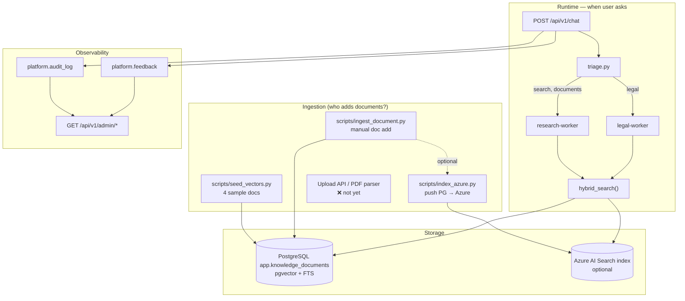

# RAG, Azure Search, Audit & Dashboard — Complete Guide

> Straight answer: **the search/RAG code is runnable**, but **ingestion, Azure index, audit, and dashboard** are still at a foundational level — this doc explains what exists, what does not, and how to set up each piece step by step.

---

## 1. Big picture



---

## 2. Actual status table

| Component | Status | Main file |
|-----------|--------|-----------|
| pgvector table | ✅ Schema + search | `infra/database/migrations/005_pgvector.sql` |
| Embeddings | ✅ OpenRouter/OpenAI | `core/search/embeddings.py` |
| Hybrid search | ✅ Azure → pgvector → FTS | `core/search/hybrid.py` |
| Azure Search **query** | ✅ Client reads index | `core/search/azure_search.py` |
| Azure Search **indexing** | ⚠️ Manual script | `scripts/index_azure.py` |
| Seed 4 sample docs | ✅ | `scripts/seed_vectors.py` |
| Ingest CLI | ✅ | `scripts/ingest_document.py` |
| Upload API / PDF parser | ✅ | `POST /admin/knowledge/upload` |
| Chunk preview + eval | ✅ | `POST /admin/knowledge/chunk-preview`, `chunk-eval` |
| Azure Blob indexer | ❌ Doc only | `docs/14-AZURE-BLOB-INDEXER.md` |
| Audit write to DB | ✅ Basic | `core/observability/audit.py` |
| Audit read API | ✅ | `GET /api/v1/admin/audit` |
| Feedback write | ✅ POST | `POST /api/v1/feedback` |
| Feedback read API | ✅ | `GET /api/v1/admin/feedback` |
| Dashboard stats | ✅ Basic | `GET /api/v1/admin/stats` |
| Ingest via API | ✅ | `POST /api/v1/admin/knowledge` |

---

## 3. When does the agent call search?

The agent **does not decide on its own** whether to call Azure or pgvector. Flow:

```
User message
  → triage (core/control/triage.py)
  → planner selects worker
  → research-worker / legal-worker
  → hybrid_search()  ← backend decision happens here
```

### Triage routes to search when the message contains:

| Worker | Trigger keywords (no diacritics) |
|--------|----------------------------------|
| `research-worker` | `tim kiem`, `tra cuu`, `search`, `tai lieu`, `tim hieu`, `research`, `nguon`, `reference`, `wiki` |
| `legal-agent` | `phap luat`, `luat`, `nghi dinh`, `dieu khoan`, `tranh chap`, `soan hop dong`, `legal`, `compliance`... |

**Examples:**
- `"Tìm tài liệu về hợp đồng lao động"` → research-worker → hybrid_search
- `"Phân tích điều khoản thanh toán theo pháp luật"` → legal-agent → hybrid_search(domain="legal")
- `"Có bao nhiêu hợp đồng active?"` → db-worker → **does not** call search

### How does hybrid_search choose a backend?

```
1. AZURE_SEARCH_* configured? → azure_search(query)
2. Not enough results? → pgvector → FTS
3. research/legal worker + TAVILY_API_KEY set? → web_search (Tavily)
```

**Citations are required:** `[D1]` = knowledge, `[W1]` = web. End of response includes `## References` + `citations` field in the API.

```env
TAVILY_API_KEY=tvly-...   # https://tavily.com/
```

**When should you enable Azure Search?**
- Production with large documents (PDF, wiki, SharePoint) already indexed on Azure
- Need cloud-scale semantic search without embedding everything into PG
- Local dev: **pgvector only** — Azure is optional

---

## 4. Vector DB (pgvector) — Who embeds, who writes?

### Table: `app.knowledge_documents`

| Column | Description |
|--------|-------------|
| `doc_id` | Unique ID |
| `title`, `content` | Searchable content |
| `domain` | `general` \| `legal` \| ... |
| `source` | `seed`, `manual`, `upload`... |
| `embedding` | vector(1536) — from `text-embedding-3-small` |
| `tsv` | FTS auto-generated |

### Who creates embeddings?

| When | Who | How |
|------|-----|-----|
| **Ingest** (write doc) | `embed_text(title + content)` | `scripts/ingest_document.py` or `seed_vectors.py` |
| **Search** (read) | `embed_text(query)` | `vector_search()` when user asks |

Provider: configured via `.env` — `EMBEDDING_PROVIDER` + `EMBEDDING_MODEL`.

| Provider | Example model | Key |
|----------|---------------|-----|
| `openai` | `text-embedding-ada-002` | `OPENAI_API_KEY` |
| `openrouter` | `openai/text-embedding-ada-002` | `OPENROUTER_API_KEY` |
| `azure` | deployment `text-embedding-ada-002` | `AZURE_OPENAI_*` |

**Note:** `ada-002` and `3-small` are both 1536 dims. Changing model requires **re-indexing** all documents.

**No API key?** Search still works via FTS/ILIKE, but without semantic vectors.

### How to add documents to pgvector

```powershell
# 1. API key required for embedding
# .env: OPENROUTER_API_KEY=sk-or-v1-...

# 2. Seed 4 sample docs
python scripts/seed_vectors.py

# 3. Add doc manually
python scripts/ingest_document.py `
  --doc-id "policy-2024" `
  --title "Chính sách bảo mật" `
  --content "Nội dung đầy đủ..." `
  --domain general

# 4. Or via API (admin only: X-API-Key with API_KEY set in .env, or a signed-in admin
#    session cookie + X-Requested-With header; see docs/12-LOCAL-SETUP.md)
curl -X POST http://localhost:8000/api/v1/admin/knowledge `
  -H "Content-Type: application/json" `
  -H "X-API-Key: your-key" `
  -d "{\"doc_id\":\"policy-2024\",\"title\":\"...\",\"content\":\"...\",\"domain\":\"general\"}"
```

**DB permissions note:** Ingest scripts use `MIGRATE_DATABASE_URL` (user `multiagent`). Runtime search uses `DATABASE_URL` (user `agent_reader`, read-only) — correct security design.

### Verify

```sql
SELECT doc_id, title, domain,
       embedding IS NOT NULL AS has_embedding,
       length(content) AS chars
FROM app.knowledge_documents;
```

---

## 5. Azure AI Search — Setup from scratch

### Step 1: Create Azure AI Search resource

1. Azure Portal → Create **Azure AI Search**
2. Choose tier: **Free** (dev) or **Basic** (prod)
3. Get **URL** (endpoint) and **Admin API Key**

### Step 2: Create index

The index needs these fields (matching code in `azure_search.py`):

```json
{
  "name": "knowledge-index",
  "fields": [
    {"name": "id", "type": "Edm.String", "key": true, "filterable": true},
    {"name": "doc_id", "type": "Edm.String", "filterable": true},
    {"name": "title", "type": "Edm.String", "searchable": true},
    {"name": "content", "type": "Edm.String", "searchable": true},
    {"name": "domain", "type": "Edm.String", "filterable": true, "facetable": true},
    {"name": "source", "type": "Edm.String", "filterable": true}
  ]
}
```

Create via Azure Portal (Indexes → Add index) or REST API.

> **Vector search on Azure:** Current code uses **keyword search** (`search_text=query`). For vector search on Azure, add a `contentVector` field + skillset — not implemented yet; use pgvector for local semantic search.

### Step 3: Fill in `.env`

```env
AZURE_SEARCH_ENDPOINT=https://YOUR-SEARCH.search.windows.net
AZURE_SEARCH_API_KEY=your-admin-key
AZURE_SEARCH_INDEX_NAME=knowledge-index
```

### Step 4: Push documents to Azure

**Method A — from PostgreSQL (already in PG):**

```powershell
python scripts/index_azure.py
# Reads app.knowledge_documents → uploads to Azure index
```

**Method B — manually via Azure Portal:**

Indexes → knowledge-index → Import data → JSON:

```json
{
  "id": "legal-contract-basics",
  "doc_id": "legal-contract-basics",
  "title": "Cơ bản về hợp đồng dân sự",
  "content": "Hợp đồng là sự thỏa thuận...",
  "domain": "legal",
  "source": "manual"
}
```

**Method C — Azure Blob + Indexer (production):**

1. Upload file to Blob Storage
2. Create Data Source → Indexer → Skillset (chunking)
3. Indexer auto-syncs — **not in repo**, set up on Azure Portal

### Step 5: Test

```powershell
# Message that triggers research
curl -X POST http://localhost:8000/api/v1/chat `
  -H "Content-Type: application/json" `
  -H "X-API-Key: your-key" `
  -d "{\"message\": \"Tìm tài liệu về hợp đồng lao động\"}"
```

In the response, check `worker_results[].tools_called` — if `"azure_search"` appears, Azure was called.

---

## 6. Audit log

### Schema: `platform.audit_log`

| Column | Description |
|--------|-------------|
| `trace_id` | ID per chat request |
| `session_id`, `user_id` | Session/user |
| `agent_name` | Worker or `gateway` |
| `action` | `chat_start`, `chat_complete`, `chat_error`... |
| `payload` | JSON metadata |
| `sql_executed` | SQL if db-worker ran |

### Where is it written?

- `workflows/runner.py` — writes `chat_start` / `chat_complete` / `chat_error`
- Future: db-worker writes `sql_executed`, each agent writes its own action

### Read via API

```powershell
curl http://localhost:8000/api/v1/admin/audit?limit=20 `
  -H "X-API-Key: your-key"
```

Or pgAdmin:

```sql
SELECT trace_id, agent_name, action, created_at
FROM platform.audit_log
ORDER BY created_at DESC
LIMIT 20;
```

---

## 7. Dashboard endpoints

All under `/api/v1/admin/*` — **admin only**: sign in as an admin (session cookie), or send `X-API-Key` (needs `API_KEY` set in `.env`; an empty `API_KEY` does not open the API). Without either: `401`. A non-admin user: `403`. `/api/v1/models` and `/api/v1/mcp/catalog` are admin only too. With a cookie session, unsafe methods (`POST`/`PUT`/`PATCH`/`DELETE`) also need the header `X-Requested-With: XMLHttpRequest`. See `docs/12-LOCAL-SETUP.md`.

| Endpoint | Method | Description |
|----------|--------|-------------|
| `/api/v1/admin/stats` | GET | Overview: docs, feedback, audit, sessions |
| `/api/v1/admin/audit` | GET | Audit log (`?limit=50&trace_id=...`) |
| `/api/v1/admin/feedback` | GET | Feedback (`?limit=50`) |
| `/api/v1/admin/knowledge` | GET | List knowledge docs (no embedding returned) |
| `/api/v1/admin/knowledge` | POST | Ingest new doc |
| `/health` | GET | Health check (public) |
| `/api/v1/models` | GET | Model routing info |
| `/api/v1/chat` | POST | Main chat (any signed-in user) |
| `/api/v1/feedback` | POST | User submits rating (any signed-in user) |

**Not yet available:** UI dashboard, Prometheus metrics, Langfuse tracing, session replay.

---

## 8. Feedback

```powershell
# After chat, get trace_id from response
curl -X POST http://localhost:8000/api/v1/feedback `
  -H "Content-Type: application/json" `
  -H "X-API-Key: your-key" `
  -d "{\"trace_id\": \"abc123...\", \"rating\": 5, \"comment\": \"Hay\"}"
```

Saved to `platform.feedback` + in-memory. Read back:

```powershell
curl http://localhost:8000/api/v1/admin/feedback?limit=10 `
  -H "X-API-Key: your-key"
```

---

## 9. Environment setup checklist

### Local dev (minimum)

```powershell
docker compose up -d
copy .env.example .env
# Add OPENROUTER_API_KEY
python scripts/db_migrate.py
python scripts/seed.py
python scripts/seed_vectors.py
python -m gateway.main
```

→ pgvector + FTS, no Azure needed.

### Local + Azure Search

Add to checklist:
1. Create Azure Search resource + index (section 5)
2. Fill in `AZURE_SEARCH_*` in `.env`
3. `python scripts/index_azure.py`
4. Test chat with keyword `tìm tài liệu`

### Production (recommended)

| Layer | Recommendation |
|-------|----------------|
| Large documents | Azure Blob + Indexer → Azure Search |
| Small internal docs | pgvector in Azure PostgreSQL |
| Embeddings | Azure OpenAI `text-embedding-3-small` (not wired yet — use OpenRouter temporarily) |
| Audit | Enable `PLATFORM_DATABASE_URL`, monitor via admin API |
| Auth | Set a strong `AUTH_SECRET_KEY`; keep `AUTH_COOKIE_SECURE=true` behind HTTPS; set `API_KEY` only if scripts need it |

---

## 12. Query embedding — where and when is it called?

**Already implemented** — but deep in the call chain, easy to miss:

```
hybrid_search(query)
  → vector_search(query)          # core/search/pgvector_store.py
      → embed_query(query)        # core/search/embeddings.py  ← EMBED QUERY HERE
      → SQL: ORDER BY embedding <=> :query_vec
```

| When | Function | Input |
|------|----------|-------|
| **Ingest** (write doc) | `embed_text(title + content)` | Chunk content |
| **Search** (user asks) | `embed_query(query)` | User question |

Log when running API (LOG_LEVEL=INFO):
```
INFO Embedded query: model=openai/text-embedding-3-small dims=1536 chars=42
```

If no API key → `vector_search` falls back to FTS, does not embed query.

---

## 13. Chunking — file upload & quality checks

### File ingest flow

```
Upload PDF/DOCX/TXT
  → parse_file()           # core/search/parsers.py
  → chunk_text()           # core/search/chunking.py
  → analyze_chunks()       # quality score + warnings
  → embed_text() per chunk
  → upsert_document()      # doc_id = parent__chunk_0000
```

Default config (`.env`):
```env
CHUNK_SIZE=800        # ~200 tokens
CHUNK_OVERLAP=120     # overlap between adjacent chunks
```

### Step 1 — Preview chunks (no DB write)

```powershell
python scripts/ingest_file.py docs/sample.pdf --preview

# Or API:
curl -X POST http://localhost:8000/api/v1/admin/knowledge/upload `
  -H "X-API-Key: your-key" `
  -F "file=@sample.pdf" `
  -F "preview_only=true"
```

Response includes:
- `analysis.quality_score` (0–1)
- `analysis.warnings` — chunk too short/long, variance...
- `chunks[].preview` — view each chunk

### Step 2 — Evaluate chunks with sample query

**Important:** Before production ingest, test with real questions users will ask.

```powershell
python scripts/ingest_file.py docs/sample.pdf --preview `
  --eval-query "điều khoản thanh toán hợp đồng"
```

Or API:
```powershell
curl -X POST http://localhost:8000/api/v1/admin/knowledge/chunk-eval `
  -H "Content-Type: application/json" `
  -H "X-API-Key: your-key" `
  -d "{\"content\": \"...\", \"query\": \"điều khoản thanh toán\"}"
```

Response:
- `rankings` — which chunks score highest for the query
- `recommendation` — suggestions to adjust chunk_size/overlap

**How to read results:**

| Signal | Meaning | Action |
|--------|---------|--------|
| Top score < 0.5 | Chunks don't match query | Decrease `CHUNK_SIZE`, increase overlap |
| Many chunks with similar scores | Too much overlap / duplicate chunks | Decrease `CHUNK_OVERLAP` |
| `warnings: too short` | Chunk loses context | Increase `CHUNK_SIZE` |
| `warnings: 1 chunk` | Long file but no split | Decrease `CHUNK_SIZE` |

### Step 3 — Actual ingest

```powershell
python scripts/ingest_file.py docs/sample.pdf --domain legal

# Or upload API:
curl -X POST http://localhost:8000/api/v1/admin/knowledge/upload `
  -H "X-API-Key: your-key" `
  -F "file=@sample.pdf" `
  -F "domain=legal"
```

View saved chunks:
```powershell
curl http://localhost:8000/api/v1/admin/knowledge/my-doc/chunks `
  -H "X-API-Key: your-key"
```

### Required migration

```powershell
python scripts/db_migrate.py   # adds migration 007 (parent_doc_id, chunk_index)
```

---

## 14. Roadmap — what's still missing?

| Priority | Task | Status |
|----------|------|--------|
| P1 | Upload PDF/DOCX + chunking | ✅ Done |
| P1 | Chunk quality preview/eval | ✅ Done |
| P1 | LLM-as-judge + reranker | ✅ Done |
| P1 | Azure Blob auto indexer | 📄 Doc: `14-AZURE-BLOB-INDEXER.md` |
| P2 | RRF hybrid fusion (parallel retrievers) | ✅ `core/search/fusion.py`, `hybrid.py` |
| P2 | Langfuse tracing (optional) | ✅ `LANGFUSE_TRACING_ENABLED=true` |
| P2 | Admin overview API | ✅ `GET /api/v1/admin/overview` |
| P2 | Vector search on Azure | ❌ |
| P2 | Dashboard UI (React) | ❌ |

---

## 15. FAQ (supplement)

**Q: I don't see where query embedding happens?**
→ `core/search/pgvector_store.py` → `vector_search()` → `embed_query()`. Set `LOG_LEVEL=INFO` to see logs.

**Q: Is chunking reasonable — how do I know?**
→ Use `--preview` + `--eval-query` or `POST /chunk-eval` before ingest.

**Q: Does each chunk have its own embedding?**
→ Yes. Each chunk = 1 row in `knowledge_documents`, each row has 1 vector.

**Q: Azure Blob indexer?**
→ See `docs/14-AZURE-BLOB-INDEXER.md` — set up on Azure Portal, does not run in local code.
