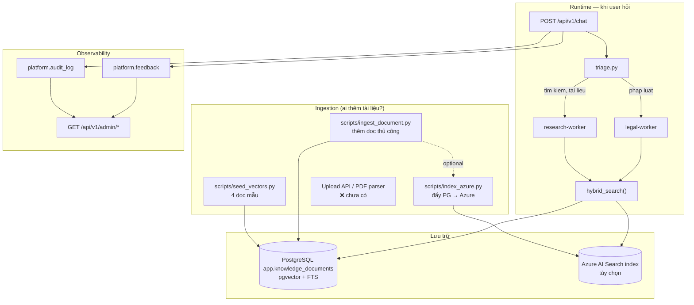

# RAG, Azure Search, Audit & Dashboard — Hướng dẫn đầy đủ

> Trả lời thẳng: **phần search/RAG đã có code chạy được**, nhưng **ingestion, Azure index, audit, dashboard** mới ở mức nền tảng — doc này giải thích cái gì có, cái gì chưa, và cách setup từng bước.

---

## 1. Bức tranh tổng thể



---

## 2. Bảng trạng thái thực tế

| Thành phần | Trạng thái | File chính |
|------------|-----------|------------|
| pgvector table | ✅ Schema + search | `infra/database/migrations/005_pgvector.sql` |
| Embeddings | ✅ OpenRouter/OpenAI | `core/search/embeddings.py` |
| Hybrid search | ✅ Azure → pgvector → FTS | `core/search/hybrid.py` |
| Azure Search **query** | ✅ Client đọc index | `core/search/azure_search.py` |
| Azure Search **indexing** | ⚠️ Script thủ công | `scripts/index_azure.py` |
| Seed 4 doc mẫu | ✅ | `scripts/seed_vectors.py` |
| Ingest CLI | ✅ | `scripts/ingest_document.py` |
| Upload API / PDF parser | ✅ | `POST /admin/knowledge/upload` |
| Chunk preview + eval | ✅ | `POST /admin/knowledge/chunk-preview`, `chunk-eval` |
| Azure Blob indexer | ❌ Doc only | `docs/14-AZURE-BLOB-INDEXER.md` |
| Audit ghi DB | ✅ Cơ bản | `core/observability/audit.py` |
| Audit đọc API | ✅ | `GET /api/v1/admin/audit` |
| Feedback ghi | ✅ POST | `POST /api/v1/feedback` |
| Feedback đọc API | ✅ | `GET /api/v1/admin/feedback` |
| Dashboard stats | ✅ Cơ bản | `GET /api/v1/admin/stats` |
| Ingest qua API | ✅ | `POST /api/v1/admin/knowledge` |

---

## 3. Khi nào agent gọi search?

Agent **không tự quyết** gọi Azure hay pgvector. Flow:

```
User message
  → triage (core/control/triage.py)
  → planner chọn worker
  → research-worker / legal-worker
  → hybrid_search()  ← quyết định backend ở đây
```

### Triage route sang search khi message chứa:

| Worker | Từ khóa trigger (không dấu) |
|--------|----------------------------|
| `research-worker` | `tim kiem`, `tra cuu`, `search`, `tai lieu`, `tim hieu`, `research`, `nguon`, `reference`, `wiki` |
| `legal-agent` | `phap luat`, `luat`, `nghi dinh`, `dieu khoan`, `tranh chap`, `soan hop dong`, `legal`, `compliance`... |

**Ví dụ:**
- `"Tìm tài liệu về hợp đồng lao động"` → research-worker → hybrid_search
- `"Phân tích điều khoản thanh toán theo pháp luật"` → legal-agent → hybrid_search(domain="legal")
- `"Có bao nhiêu hợp đồng active?"` → db-worker → **không** gọi search

### hybrid_search chọn backend thế nào?

```
1. Có AZURE_SEARCH_*? → azure_search(query)
2. Chưa đủ? → pgvector → FTS
3. research/legal worker + có TAVILY_API_KEY? → web_search (Tavily)
```

**Trích dẫn bắt buộc:** `[D1]` = knowledge, `[W1]` = web. Cuối response có `## Nguồn tham khảo` + field `citations` trong API.

```env
TAVILY_API_KEY=tvly-...   # https://tavily.com/
```

**Khi nào nên bật Azure Search?**
- Production có tài liệu lớn (PDF, wiki, SharePoint) đã index trên Azure
- Cần semantic search cloud-scale, không muốn embed hết vào PG
- Local dev: **chỉ cần pgvector** — Azure là optional

---

## 4. Vector DB (pgvector) — Ai embed, ai ghi?

### Bảng: `app.knowledge_documents`

| Cột | Mô tả |
|-----|-------|
| `doc_id` | ID duy nhất |
| `title`, `content` | Nội dung tìm kiếm |
| `domain` | `general` \| `legal` \| ... |
| `source` | `seed`, `manual`, `upload`... |
| `embedding` | vector(1536) — từ `text-embedding-3-small` |
| `tsv` | FTS auto-generated |

### Ai tạo embedding?

| Thời điểm | Ai | Cách |
|-----------|-----|------|
| **Ingest** (ghi doc) | `embed_text(title + content)` | `scripts/ingest_document.py` hoặc `seed_vectors.py` |
| **Search** (đọc) | `embed_text(query)` | `vector_search()` khi user hỏi |

Provider: cấu hình qua `.env` — `EMBEDDING_PROVIDER` + `EMBEDDING_MODEL`.

| Provider | Ví dụ model | Key |
|----------|-------------|-----|
| `openai` | `text-embedding-ada-002` | `OPENAI_API_KEY` |
| `openrouter` | `openai/text-embedding-ada-002` | `OPENROUTER_API_KEY` |
| `azure` | deployment `text-embedding-ada-002` | `AZURE_OPENAI_*` |

**Lưu ý:** `ada-002` và `3-small` đều 1536 dims. Đổi model phải **re-index** toàn bộ documents.

**Không có API key?** Vẫn search được qua FTS/ILIKE, nhưng không có semantic vector.

### Cách thêm tài liệu vào pgvector

```powershell
# 1. Cần API key cho embedding
# .env: OPENROUTER_API_KEY=sk-or-v1-...

# 2. Seed 4 doc mẫu
python scripts/seed_vectors.py

# 3. Thêm doc thủ công
python scripts/ingest_document.py `
  --doc-id "policy-2024" `
  --title "Chính sách bảo mật" `
  --content "Nội dung đầy đủ..." `
  --domain general

# 4. Hoặc qua API (cần API_KEY nếu đã bật auth)
curl -X POST http://localhost:8000/api/v1/admin/knowledge `
  -H "Content-Type: application/json" `
  -H "X-API-Key: your-key" `
  -d "{\"doc_id\":\"policy-2024\",\"title\":\"...\",\"content\":\"...\",\"domain\":\"general\"}"
```

**Lưu ý quyền DB:** Script ingest dùng `MIGRATE_DATABASE_URL` (user `phanlaw`). Runtime search dùng `DATABASE_URL` (user `agent_reader`, read-only) — đúng thiết kế bảo mật.

### Verify

```sql
SELECT doc_id, title, domain,
       embedding IS NOT NULL AS has_embedding,
       length(content) AS chars
FROM app.knowledge_documents;
```

---

## 5. Azure AI Search — Setup từ đầu

### Bước 1: Tạo Azure AI Search resource

1. Azure Portal → Create **Azure AI Search**
2. Chọn tier: **Free** (dev) hoặc **Basic** (prod)
3. Lấy **URL** (endpoint) và **Admin API Key**

### Bước 2: Tạo index

Index cần các field sau (khớp code trong `azure_search.py`):

```json
{
  "name": "knowledge-index",
  "fields": [
    {"name": "id", "type": "Edm.String", "key": true, "filterable": true},
    {"name": "doc_id", "type": "Edm.String", "filterable": true},
    {"name": "title", "type": "Edm.String", "searchable": true},
    {"name": "content", "type": "Edm.String", "searchable": true},
    {"name": "domain", "type": "Edm.String", "filterable": true, "facetable": true},
    {"name": "source", "type": "Edm.String", "filterable": true}
  ]
}
```

Tạo qua Azure Portal (Indexes → Add index) hoặc REST API.

> **Vector search trên Azure:** Code hiện tại dùng **keyword search** (`search_text=query`). Nếu cần vector trên Azure, phải thêm field `contentVector` + skillset — chưa implement, dùng pgvector cho semantic local.

### Bước 3: Điền `.env`

```env
AZURE_SEARCH_ENDPOINT=https://YOUR-SEARCH.search.windows.net
AZURE_SEARCH_API_KEY=your-admin-key
AZURE_SEARCH_INDEX_NAME=knowledge-index
```

### Bước 4: Đẩy tài liệu lên Azure

**Cách A — từ PostgreSQL (đã có trong PG):**

```powershell
python scripts/index_azure.py
# Đọc app.knowledge_documents → upload lên Azure index
```

**Cách B — thủ công qua Azure Portal:**

Indexes → knowledge-index → Import data → JSON:

```json
{
  "id": "legal-contract-basics",
  "doc_id": "legal-contract-basics",
  "title": "Cơ bản về hợp đồng dân sự",
  "content": "Hợp đồng là sự thỏa thuận...",
  "domain": "legal",
  "source": "manual"
}
```

**Cách C — Azure Blob + Indexer (production):**

1. Upload file lên Blob Storage
2. Tạo Data Source → Indexer → Skillset (chunking)
3. Indexer tự sync — **chưa có trong repo**, cần setup trên Azure Portal

### Bước 5: Test

```powershell
# Message trigger research
curl -X POST http://localhost:8000/api/v1/chat `
  -H "Content-Type: application/json" `
  -d "{\"message\": \"Tìm tài liệu về hợp đồng lao động\"}"
```

Trong response, xem `worker_results[].tools_called` — nếu có `"azure_search"` là Azure đã được gọi.

---

## 6. Audit log

### Schema: `platform.audit_log`

| Cột | Mô tả |
|-----|-------|
| `trace_id` | ID mỗi request chat |
| `session_id`, `user_id` | Session/user |
| `agent_name` | Worker hoặc `gateway` |
| `action` | `chat_start`, `chat_complete`, `chat_error`... |
| `payload` | JSON metadata |
| `sql_executed` | SQL nếu db-worker chạy |

### Ghi ở đâu?

- `workflows/runner.py` — ghi `chat_start` / `chat_complete` / `chat_error`
- Tương lai: db-worker ghi `sql_executed`, từng agent ghi action riêng

### Đọc qua API

```powershell
curl http://localhost:8000/api/v1/admin/audit?limit=20 `
  -H "X-API-Key: your-key"
```

Hoặc pgAdmin:

```sql
SELECT trace_id, agent_name, action, created_at
FROM platform.audit_log
ORDER BY created_at DESC
LIMIT 20;
```

---

## 7. Dashboard endpoints

Tất cả dưới `/api/v1/admin/*` — yêu cầu `X-API-Key` nếu `API_KEY` đã set trong `.env`.

| Endpoint | Method | Mô tả |
|----------|--------|-------|
| `/api/v1/admin/stats` | GET | Tổng quan: docs, feedback, audit, sessions |
| `/api/v1/admin/audit` | GET | Audit log (`?limit=50&trace_id=...`) |
| `/api/v1/admin/feedback` | GET | Feedback (`?limit=50`) |
| `/api/v1/admin/knowledge` | GET | List knowledge docs (không trả embedding) |
| `/api/v1/admin/knowledge` | POST | Ingest doc mới |
| `/health` | GET | Health check (public) |
| `/api/v1/models` | GET | Model routing info |
| `/api/v1/chat` | POST | Chat chính |
| `/api/v1/feedback` | POST | User gửi rating |

**Chưa có:** UI dashboard, Prometheus metrics, Langfuse tracing, session replay.

---

## 8. Feedback

```powershell
# Sau khi chat, lấy trace_id từ response
curl -X POST http://localhost:8000/api/v1/feedback `
  -H "Content-Type: application/json" `
  -d "{\"trace_id\": \"abc123...\", \"rating\": 5, \"comment\": \"Hay\"}"
```

Lưu vào `platform.feedback` + in-memory. Đọc lại:

```powershell
curl http://localhost:8000/api/v1/admin/feedback?limit=10
```

---

## 9. Checklist setup theo môi trường

### Local dev (tối thiểu)

```powershell
docker compose up -d
copy .env.example .env
# Thêm OPENROUTER_API_KEY
python scripts/db_migrate.py
python scripts/seed.py
python scripts/seed_vectors.py
python -m gateway.main
```

→ pgvector + FTS, không cần Azure.

### Local + Azure Search

Thêm vào checklist:
1. Tạo Azure Search resource + index (mục 5)
2. Điền `AZURE_SEARCH_*` trong `.env`
3. `python scripts/index_azure.py`
4. Test chat với keyword `tìm tài liệu`

### Production (đề xuất)

| Layer | Khuyến nghị |
|-------|-------------|
| Tài liệu lớn | Azure Blob + Indexer → Azure Search |
| Tài liệu nội bộ nhỏ | pgvector trong Azure PostgreSQL |
| Embeddings | Azure OpenAI `text-embedding-3-small` (chưa wire — dùng OpenRouter tạm) |
| Audit | Bật `PLATFORM_DATABASE_URL`, monitor qua admin API |
| Auth | Set `API_KEY` production |

---

## 12. Query embedding — ở đâu, khi nào gọi?

**Có rồi** — nhưng nằm sâu trong call chain, dễ bỏ qua:

```
hybrid_search(query)
  → vector_search(query)          # core/search/pgvector_store.py
      → embed_query(query)        # core/search/embeddings.py  ← EMBED QUERY Ở ĐÂY
      → SQL: ORDER BY embedding <=> :query_vec
```

| Thời điểm | Hàm | Input |
|-----------|-----|-------|
| **Ingest** (ghi doc) | `embed_text(title + content)` | Nội dung chunk |
| **Search** (user hỏi) | `embed_query(query)` | Câu hỏi user |

Log khi chạy API (LOG_LEVEL=INFO):
```
INFO Embedded query: model=openai/text-embedding-3-small dims=1536 chars=42
```

Nếu không có API key → `vector_search` fallback sang FTS, không embed query.

---

## 13. Chunking — upload file & kiểm tra chất lượng

### Flow ingest file

```
Upload PDF/DOCX/TXT
  → parse_file()           # core/search/parsers.py
  → chunk_text()           # core/search/chunking.py
  → analyze_chunks()       # quality score + warnings
  → embed_text() mỗi chunk
  → upsert_document()      # doc_id = parent__chunk_0000
```

Config mặc định (`.env`):
```env
CHUNK_SIZE=800        # ~200 tokens
CHUNK_OVERLAP=120     # overlap giữa chunks liền kề
```

### Bước 1 — Preview chunks (không ghi DB)

```powershell
python scripts/ingest_file.py docs/sample.pdf --preview

# Hoặc API:
curl -X POST http://localhost:8000/api/v1/admin/knowledge/upload `
  -F "file=@sample.pdf" `
  -F "preview_only=true"
```

Response gồm:
- `analysis.quality_score` (0–1)
- `analysis.warnings` — chunk quá ngắn/dài, chênh lệch...
- `chunks[].preview` — xem từng chunk

### Bước 2 — Đánh giá chunk với query mẫu

**Quan trọng:** Trước khi ingest production, test với câu hỏi thực tế user sẽ hỏi.

```powershell
python scripts/ingest_file.py docs/sample.pdf --preview `
  --eval-query "điều khoản thanh toán hợp đồng"
```

Hoặc API:
```powershell
curl -X POST http://localhost:8000/api/v1/admin/knowledge/chunk-eval `
  -H "Content-Type: application/json" `
  -d "{\"content\": \"...\", \"query\": \"điều khoản thanh toán\"}"
```

Response:
- `rankings` — chunk nào score cao nhất với query
- `recommendation` — gợi ý chỉnh chunk_size/overlap

**Cách đọc kết quả:**

| Dấu hiệu | Ý nghĩa | Hành động |
|----------|---------|-----------|
| Top score < 0.5 | Chunk không khớp query | Giảm `CHUNK_SIZE`, tăng overlap |
| Nhiều chunk score gần nhau | Overlap quá nhiều / chunk giống nhau | Giảm `CHUNK_OVERLAP` |
| `warnings: quá ngắn` | Chunk mất ngữ cảnh | Tăng `CHUNK_SIZE` |
| `warnings: 1 chunk` | File dài nhưng không split | Giảm `CHUNK_SIZE` |

### Bước 3 — Ingest thật

```powershell
python scripts/ingest_file.py docs/sample.pdf --domain legal

# Hoặc upload API:
curl -X POST http://localhost:8000/api/v1/admin/knowledge/upload `
  -F "file=@sample.pdf" `
  -F "domain=legal"
```

Xem chunks đã lưu:
```powershell
curl http://localhost:8000/api/v1/admin/knowledge/my-doc/chunks
```

### Migration cần chạy

```powershell
python scripts/db_migrate.py   # thêm migration 007 (parent_doc_id, chunk_index)
```

---

## 14. Roadmap — còn thiếu gì?

| Ưu tiên | Task | Trạng thái |
|---------|------|------------|
| P1 | Upload PDF/DOCX + chunking | ✅ Done |
| P1 | Chunk quality preview/eval | ✅ Done |
| P1 | LLM-as-judge + reranker | ✅ Done |
| P1 | Azure Blob indexer tự động | 📄 Doc: `14-AZURE-BLOB-INDEXER.md` |
| P2 | RRF hybrid fusion (parallel retrievers) | ✅ `core/search/fusion.py`, `hybrid.py` |
| P2 | Langfuse tracing (optional) | ✅ `LANGFUSE_TRACING_ENABLED=true` |
| P2 | Admin overview API | ✅ `GET /api/v1/admin/overview` |
| P2 | Vector search trên Azure | ❌ |
| P2 | Dashboard UI (React) | ❌ |

---

## 15. FAQ (bổ sung)

**Q: Tôi không thấy chỗ embed query?**
→ `core/search/pgvector_store.py` → `vector_search()` → `embed_query()`. Bật `LOG_LEVEL=INFO` để thấy log.

**Q: Chunking có hợp lý không — làm sao biết?**
→ Dùng `--preview` + `--eval-query` hoặc `POST /chunk-eval` trước khi ingest.

**Q: Mỗi chunk có embedding riêng?**
→ Đúng. Mỗi chunk = 1 row trong `knowledge_documents`, mỗi row 1 vector.

**Q: Azure Blob indexer?**
→ Xem `docs/14-AZURE-BLOB-INDEXER.md` — setup trên Azure Portal, không chạy trong code local.
